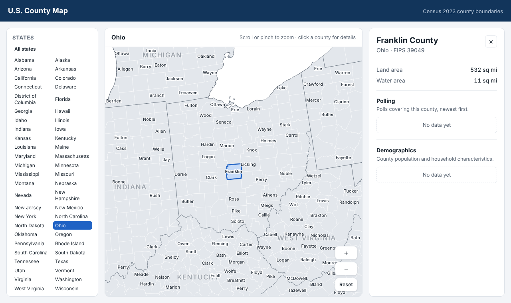

# U.S. County Map

An interactive map of every U.S. county, labeled with state and county names.
Click a county to open its details panel, where polling and demographic data
will appear once it's added.



- **Map**: all 3,144 counties and county-equivalents from the Census Bureau's
  2023 cartographic boundaries (50 states + DC, with Alaska and Hawaii as
  insets). Connecticut uses its nine planning regions (09110–09190), matching
  current Census and election data.
- **Labels**:
  - State names at national zoom; small Northeastern states get callouts in
    the Atlantic.
  - County names appear as you zoom in. They are placed inside each county,
    sized to fit and kept from overlapping.
- **Navigation**: scroll or pinch to zoom, drag to pan, or pick a state from
  the list to zoom to it. The selected county is kept in the URL
  (`#county=39049`), so you can link to it.
- **County panel**: the county's name, state, FIPS code and land/water area,
  plus one section per dataset (Polling and Demographics are set up but
  empty).

## How it's built

| Part | Tech | Where |
| --- | --- | --- |
| Front end | Vite, TypeScript, D3 (no UI framework) | `web/` |
| API + hosting | Python, FastAPI; also serves the built front end | `server/` |
| Data | CSV files plus a FIPS reference index | `data/` |
| Deploy | One Docker web service on Render | `Dockerfile`, `render.yaml` |

```
data/
  reference/            counties.json, states.json (generated; FIPS → names, areas)
  datasets/<id>/        meta.json + records.csv per dataset (see below)
server/app/
  main.py               app factory; serves /api and web/dist
  api.py                routes
  datasets.py           loads data/datasets/* (behind a DatasetStore protocol)
  models.py             response schemas (mirrored in web/src/types.ts)
web/src/
  main.ts               wires the map, state list and panel together
  map/MapView.ts        SVG map, zoom, hover/selection, label placement
  map/labels.ts, polylabel.ts, anchors.worker.ts   label fitting (worker thread)
  ui/CountyPanel.ts     the county details panel
  panels/               how each dataset section is drawn
web/scripts/build-geo.mjs   rebuilds map geometry from Census files
```

## Running locally

You need Python 3.12+ and Node 22+.

```sh
make setup        # Python venv in server/.venv + npm install
make dev-api      # terminal 1: FastAPI on http://localhost:8000
make dev-web      # terminal 2: Vite on http://localhost:5173 (proxies /api)
```

To run it the way production does, use `make serve`. It builds the front end
and serves everything from FastAPI on http://localhost:8000. `make docker`
builds and runs the production image.

Run `make test` for the API tests and the TypeScript type check.

## Deploying to Render

The repo includes a [Render Blueprint](https://render.com/docs/blueprint-spec)
(`render.yaml`). It defines one Docker web service: a Node stage builds the
front end, then a Python image runs the app.

1. In the [Render dashboard](https://dashboard.render.com), choose **New →
   Blueprint** and connect this GitHub repository.
2. Pick the branch to deploy and click **Apply**. Render builds the
   `Dockerfile` and checks `/api/health`.
3. Every push to that branch redeploys automatically.

The Blueprint uses the **free** plan. Free services sleep after 15 minutes
without traffic, so the first visit after a while takes 30–60 seconds while
the service wakes up. To keep it always on, switch the service to a paid
instance type in Render.

## Adding data

Each dataset is a folder under `data/datasets/`. Adding a folder adds a
section to the county panel. No code changes are needed.

```
data/datasets/demographics/
  meta.json      what the dataset is and how to show it
  records.csv    the data, one or more rows per county
```

**`records.csv`** needs a `fips` column with the 5-digit county FIPS code.
Leading zeros may be dropped (`6037` is read as `06037`). Every field listed in
`meta.json` must have a column. Other columns are ignored, and rows for
unknown FIPS codes are skipped with a warning in the server log.

```csv
fips,population,median_age,median_household_income,pct_bachelors_or_higher,pct_white,pct_black,pct_hispanic,pct_asian
39049,1323807,34.6,71070,0.443,0.627,0.244,0.068,0.055
```

**`meta.json`**:

```jsonc
{
  "title": "Demographics",
  "description": "County population and household characteristics.",
  "source": "U.S. Census Bureau, ACS 5-year estimates",  // shown under the section
  "sourceUrl": "https://data.census.gov/",               // optional link
  "updated": "2024-12-12",                                // optional
  "display": "fields",   // "fields": one row per county, shown as label/value pairs
                         // "table":  many rows per county (e.g. polls), shown as a table
  "sort": "-end_date",   // tables only: sort by this field; "-" means descending
  "order": 20,           // section order in the panel (lower first)
  "fields": [
    { "key": "population", "label": "Population", "format": "integer" },
    { "key": "median_age", "label": "Median age", "format": "number", "unit": "years" }
  ]
}
```

| Field `format` | CSV value | Shown as |
| --- | --- | --- |
| `text` | anything | as is |
| `integer` | `1323807` or `1,323,807` | 1,323,807 |
| `number` | `34.6` | 34.6 |
| `percent` | a **fraction**: `0.443` | 44.3% |
| `currency` | `71070` or `$71,070` | $71,070 |
| `date` | ISO `2024-10-28` | Oct 28, 2024 |

The Polling and Demographics folders already exist with header-only CSVs.
Fill in rows, or change their fields to match your data, then restart the
server (or redeploy).

### Going further

- **Custom panel visuals**: to draw a dataset your own way (a poll trend
  chart, for example), register a renderer in `web/src/main.ts`:
  ```ts
  import { registerPanel } from "./panels/registry";
  registerPanel("polling", (section, county) => myPollChart(section.rows));
  ```
- **Coloring the map by a value**: `GET /api/datasets/{id}/values?field=…`
  returns `{fips: value}` for a `fields` dataset, and
  `MapView.setFill(fips => color)` colors counties. Together they make a
  choropleth layer.
- **A database instead of CSV files**: the API reads data only through the
  `DatasetStore` protocol in `server/app/datasets.py`. A Postgres-backed store
  (Render offers managed Postgres) can replace `CsvDatasetStore` without
  changing the routes or the front end.
- **Election results**: [tonmcg's county-level results](https://github.com/tonmcg/US_County_Level_Election_Results_08-24)
  use the same 5-digit FIPS codes. Exceptions: Alaska is reported by state
  House district and DC by ward, so those rows won't match county FIPS.

## API

| Route | Returns |
| --- | --- |
| `GET /api/health` | `{status, counties, datasets}` |
| `GET /api/states` | states with FIPS, name, abbreviation, land/water area |
| `GET /api/datasets` | metadata for every dataset |
| `GET /api/counties/{fips}` | `{county, sections}`: the county plus one section per dataset (rows may be empty) |
| `GET /api/datasets/{id}/values?field=` | `{fips: value}` for one field, for map coloring |

Interactive API docs are served at `/docs`.

## Map geometry

`web/src/assets/us-counties.topo.json` and `data/reference/*.json` are
generated from the Census Bureau's `cb_2023_us_county_500k` cartographic
boundary file by `make geo` (`web/scripts/build-geo.mjs`). The script
simplifies the shapes to about 1.3 MB (370 KB gzipped) and derives the state
and national outlines from the counties, so all borders line up. Edit
`VINTAGE` or `SIMPLIFY` in the script to change the source year or the level
of detail.
